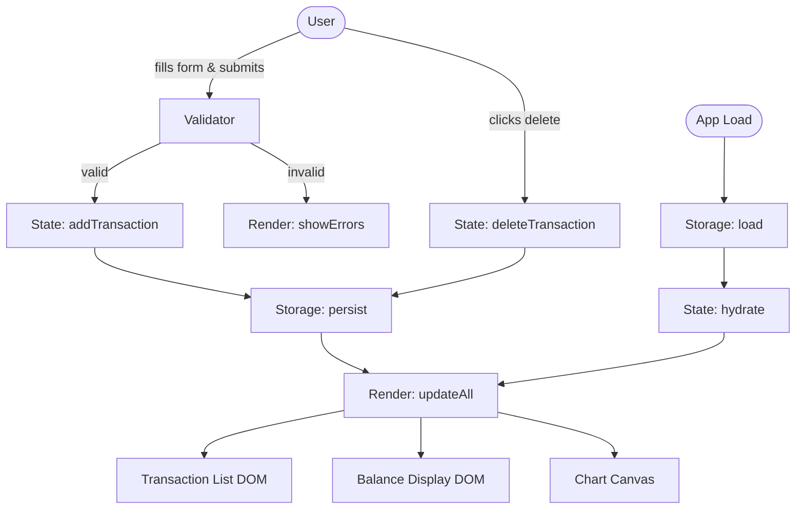

# Design Document

## Overview

The Expense and Budget Visualizer is a fully client-side single-page application (SPA) delivered as a set of static files (HTML, CSS, Vanilla JavaScript). It lets users record personal expense transactions, view them in a scrollable list, inspect their total balance, and explore spending distribution through a pie chart — all without a server or build step.

The architecture follows a **unidirectional data-flow** pattern inspired by the Elm/Redux model but implemented in plain JavaScript:

```
User Action → State Mutation → Render
```

All application state lives in a single in-memory `state` object. Every user action (add, delete, load) calls a pure transformation function that returns a new state, which is then persisted to Local Storage and passed to a set of render functions that update the DOM. No third-party framework is used; all DOM manipulation is done via the native browser API.

---

## Architecture

### High-Level Structure

```
index.html          ← single entry point; links CSS and JS
├── style.css       ← all layout, typography, and colour rules
└── app.js          ← all application logic
    ├── state.js    (module — state initialisation and transitions)
    ├── storage.js  (module — Local Storage read/write)
    ├── validator.js(module — form field validation)
    ├── renderer.js (module — DOM rendering functions)
    └── chart.js    (module — pie chart rendering via Canvas API)
```

> **Delivery note:** Because the app must open as a local file (`file://`) without a web server, ES Module `import/export` syntax cannot be used (browsers block cross-origin module requests for `file://` by default). All modules are therefore combined into a single `app.js` file using an IIFE (Immediately Invoked Function Expression) namespace pattern, or split into `<script>` tags with a globally shared namespace object. The recommended delivery is **one HTML file + one CSS file + one JS file**.

### Data-Flow Diagram



### Design Decisions

| Decision | Choice | Rationale |
|---|---|---|
| State management | Single mutable `state` object, reset on each transition | Simple for a small app; avoids complexity of immutable libraries |
| Chart rendering | HTML5 Canvas 2D API (built-in) | No external library dependency; sufficient for a pie chart |
| Persistence | `localStorage.setItem` / `getItem` with JSON | Required by spec; synchronous, no async complexity |
| Module bundling | Single `app.js` (IIFE pattern) | Works with `file://` protocol; no build tool needed |
| Validation | Synchronous, run on form submit | Simplest approach; no real-time validation overhead |
| Currency symbol | `$` (US Dollar) | Default; easily changed via a single constant |

---

## Components and Interfaces

### 1. State Module

Owns the canonical list of transactions in memory.

```js
// State shape
{
  transactions: Transaction[]   // ordered by dateAdded ascending
}

// Public API
function initState()                    // returns empty state
function addTransaction(state, tx)      // returns new state with tx appended
function deleteTransaction(state, id)   // returns new state with tx removed
function hydrateState(rawArray)         // returns state from parsed JSON array
```

### 2. Storage Module

Wraps `localStorage` with JSON serialization.

```js
const STORAGE_KEY = 'expense_budget_transactions';

function saveTransactions(transactions)   // serializes array → JSON string, writes to localStorage
function loadTransactions()               // reads from localStorage, returns parsed array or []
```

### 3. Validator Module

Pure validation — no DOM side-effects.

```js
// Returns { valid: boolean, errors: { name?: string, amount?: string, category?: string } }
function validateForm({ name, amount, category })
```

Validation rules:
- `name`: non-empty after trimming, max 100 characters
- `amount`: numeric, > 0.00, ≤ 999,999,999.99
- `category`: one of `['Food', 'Transport', 'Fun']`

### 4. Renderer Module

All DOM-write operations. Each function accepts the current state and re-renders its target element.

```js
function renderTransactionList(state)   // rebuilds <ul> contents
function renderBalanceDisplay(state)    // updates balance text node
function renderEmptyState()             // shows/hides empty-state message
function showFormErrors(errors)         // injects inline error messages into form
function clearFormErrors()              // removes all inline error messages
function resetForm()                    // clears form field values and selection
function renderAll(state)               // calls all render functions in order
```

### 5. Chart Module

Draws the pie chart on an HTML5 `<canvas>` element.

```js
function renderChart(state)             // computes category totals, draws segments
function drawEmptyChartMessage(ctx)     // draws placeholder text when no data
```

Chart colours (fixed per category):

| Category | Colour |
|---|---|
| Food | `#FF6384` |
| Transport | `#36A2EB` |
| Fun | `#FFCE56` |

### 6. Event Wiring (app.js entry point)

```js
// On DOMContentLoaded:
//   1. loadTransactions() → hydrateState() → renderAll()
//   2. Attach submit listener to form → validate → addTransaction → save → renderAll
//   3. Use event delegation on transaction list → deleteTransaction → save → renderAll
```

---

## Data Models

### Transaction

```js
/**
 * @typedef {Object} Transaction
 * @property {string}  id         - UUID v4 generated at creation time (crypto.randomUUID or fallback)
 * @property {string}  name       - Item name (1–100 chars)
 * @property {number}  amount     - Positive decimal number (max 999,999,999.99)
 * @property {string}  category   - One of: 'Food' | 'Transport' | 'Fun'
 * @property {string}  dateAdded  - ISO 8601 timestamp string (Date.toISOString())
 */
```

### AppState

```js
/**
 * @typedef {Object} AppState
 * @property {Transaction[]} transactions - All transactions, ascending by dateAdded
 */
```

### ValidationResult

```js
/**
 * @typedef {Object} ValidationResult
 * @property {boolean} valid
 * @property {{ name?: string, amount?: string, category?: string }} errors
 */
```

### Storage Format

Transactions are stored under the key `expense_budget_transactions` as a JSON array:

```json
[
  {
    "id": "3f2504e0-4f89-11d3-9a0c-0305e82c3301",
    "name": "Coffee",
    "amount": 4.50,
    "category": "Food",
    "dateAdded": "2024-06-01T09:15:00.000Z"
  }
]
```

Requirement 6.5 explicitly mandates a **round-trip property**: serializing then deserializing the array must produce a transaction list equivalent to the original.

---

## Correctness Properties

*A property is a characteristic or behavior that should hold true across all valid executions of a system — essentially, a formal statement about what the system should do. Properties serve as the bridge between human-readable specifications and machine-verifiable correctness guarantees.*

### Property 1: Storage round-trip preserves transaction data

*For any* list of valid transactions, serializing the list to JSON and then deserializing it SHALL produce a list that is structurally equivalent to the original (same length, same `id`, `name`, `amount`, `category`, and `dateAdded` values for each entry).

**Validates: Requirements 6.1, 6.2, 6.3, 6.5**

### Property 2: Validation rejects whitespace-only and empty names

*For any* string that is empty or composed entirely of whitespace characters (spaces, tabs, newlines), submitting it as the item name SHALL cause the Validator to return `valid: false` with an error on the `name` field, and the transaction list SHALL remain unchanged.

**Validates: Requirements 1.3, 1.4**

### Property 3: Validation rejects out-of-range amounts

*For any* numeric value that is ≤ 0 or > 999,999,999.99, submitting it as the transaction amount SHALL cause the Validator to return `valid: false` with an error on the `amount` field, and the transaction list SHALL remain unchanged.

**Validates: Requirements 1.3, 1.4**

### Property 4: Adding a valid transaction grows the list by exactly one

*For any* existing transaction list and any valid transaction (non-empty name, in-range amount, valid category), adding the transaction SHALL produce a new list whose length is exactly one greater than the original, and the added transaction SHALL be present in the new list.

**Validates: Requirements 1.2, 2.1**

### Property 5: Deleting a transaction removes exactly that entry

*For any* transaction list containing at least one entry, deleting a transaction by its `id` SHALL produce a new list whose length is exactly one less than the original, where no entry has the deleted `id`, and all other entries remain unchanged.

**Validates: Requirements 3.2, 3.3**

### Property 6: Balance equals the arithmetic sum of all transaction amounts

*For any* transaction list (including the empty list), the computed balance value SHALL equal the sum of the `amount` field of every transaction, rounded to exactly two decimal places. When the list is empty the balance SHALL be `0.00`.

**Validates: Requirements 4.1, 4.2, 4.3, 4.4**

### Property 7: Chart segment proportions match category totals

*For any* non-empty transaction list, the angular proportion of each category's segment in the pie chart SHALL equal that category's total `amount` divided by the grand total of all amounts, within floating-point rounding tolerance.

**Validates: Requirements 5.1, 5.2, 5.3**

### Property 8: Transaction list ordering is always ascending by insertion time

*For any* sequence of add and delete operations, the remaining transactions in the Transaction_List SHALL always appear in strictly ascending order of `dateAdded`, regardless of which transactions were deleted.

**Validates: Requirements 2.1**

---

## Error Handling

| Scenario | Behaviour |
|---|---|
| Form submitted with empty name | Inline error shown next to name field; transaction not added |
| Form submitted with non-numeric or zero/negative amount | Inline error shown next to amount field; transaction not added |
| Form submitted with no category selected | Inline error shown next to category field; transaction not added |
| `localStorage` quota exceeded on save | Catch `DOMException`, display a non-blocking toast/banner: "Unable to save — storage is full." |
| `localStorage` returns malformed JSON on load | Catch `SyntaxError`, treat as empty list, initialize fresh state |
| `crypto.randomUUID` not available (older browsers) | Fallback: generate a pseudo-UUID using `Math.random()` hex strings |
| Canvas not supported | Hide `<canvas>` element, show static text "Chart unavailable in this browser" |

All errors are user-facing messages in plain language; no raw exception messages are ever shown to the user.

---

## Testing Strategy

### Overview

Because this app is plain HTML/CSS/Vanilla JS with no build tool, testing is done with a lightweight test harness (e.g., a `test.html` file that imports `app.js` and runs assertions) or with a zero-config test runner such as [Jasmine standalone](https://jasmine.github.io/pages/getting_started.html) or [QUnit](https://qunitjs.com/) — both deliver a single JS file with no npm dependency.

**Dual testing approach:**

- **Unit / example tests** — verify specific behaviours with concrete inputs
- **Property-based tests** — verify universal invariants across randomly generated inputs using [fast-check](https://fast-check.dev/) (browser-compatible UMD build, no bundler needed)

### Unit / Example Tests

| Area | Test cases |
|---|---|
| Validator | Valid submission passes; empty name rejected; amount = 0 rejected; amount < 0 rejected; amount > 999,999,999.99 rejected; amount with 3 decimal places accepted (rounded); no category rejected |
| State | `addTransaction` appends and returns new state; `deleteTransaction` removes correct entry; `hydrateState` reconstructs correct state from raw array |
| Storage | `saveTransactions` writes JSON to localStorage; `loadTransactions` reads and parses; corrupted data returns empty array |
| Renderer | Balance shows "$0.00" on empty state; balance updates after add/delete; list shows empty-state message when empty; list shows all entries after hydration |
| Chart | No-data message shown when transactions is empty; segment count matches distinct categories present |

### Property-Based Tests

Uses **fast-check** (UMD bundle, ≥ 100 runs per property).

Each test is tagged with:

```
// Feature: expense-budget-visualizer, Property N: <property text>
```

| Property | Generator inputs | Assertion |
|---|---|---|
| **P1** Storage round-trip | Arbitrary arrays of valid Transaction objects | `JSON.parse(JSON.stringify(txList))` deep-equals original |
| **P2** Whitespace name rejection | Strings of `\s+` characters only | `validateForm({ name, amount: 1, category: 'Food' }).valid === false` |
| **P3** Out-of-range amount rejection | Numbers ≤ 0 or > 999999999.99 | `validateForm({ name: 'x', amount, category: 'Food' }).valid === false` |
| **P4** Add grows list by one | Any valid transaction + any existing state | `state.transactions.length === original.length + 1` |
| **P5** Delete shrinks list by one | Any state with ≥ 1 transaction, pick random id | `state.transactions.length === original.length - 1` and id absent |
| **P6** Balance equals sum | Any non-empty transaction list | `balanceValue === sum(amounts)` to 2 dp |
| **P7** Chart proportions | Any non-empty transaction list | For each category: `segmentAngle / (2π) ≈ categoryTotal / grandTotal` |
| **P8** Ordering stability | Any sequence of add/delete operations | Remaining transactions are sorted ascending by `dateAdded` |

### Integration / Smoke Tests

- Open `index.html` in Chrome, Firefox, Edge, Safari — verify initial render (Requirement 7.1)
- Add 10 transactions, reload page, verify all 10 are restored (Requirement 6.3)
- Resize viewport to 320 px width — verify no horizontal scrollbar (Requirement 8.3)
- Delete all transactions one-by-one — verify empty states shown in list and chart

### Accessibility Checks

- All form controls have associated `<label>` elements
- Focus indicators visible on all interactive controls (Requirement 9.4)
- Chart `<canvas>` has an `aria-label` or `<figcaption>` describing the data for screen-reader users
